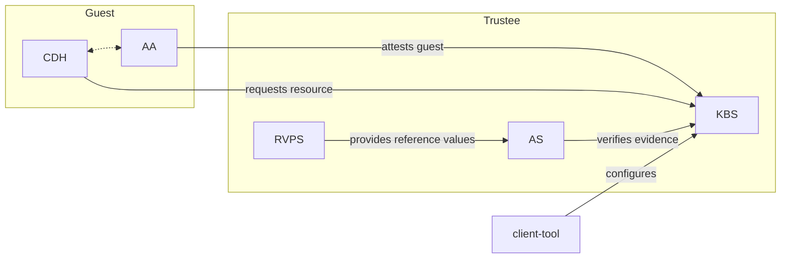

# 用于证明与机密管理的可信组件（Trusted Components for Attestation and Secret Management）

> 说明：本文件是 `README.md` 的简体中文译文，原文保持英文不变。总索引见仓库根目录 [custom-文档清单.md](custom-文档清单.md)。

本仓库包含用于证明机密 Guest（confidential guests）并向其提供机密（secrets）的工具与组件。
这些组件统称为 Trustee。
Trustee 通常代表 Guest 所有者行事，并与
[guest components](https://github.com/confidential-containers/guest-components) 进行远程交互。

Trustee 是为 Confidential Containers 项目开发的，但也可以用于非常广泛的应用与硬件平台。

## 组件（Components）

- [Key Broker Service](kbs)
KBS 是一个用于促成远程证明与机密投递的服务器。
它的角色类似于 RATS 模型中的[依赖方（Relying Party）](https://www.ietf.org/archive/id/draft-ietf-rats-architecture-22.html#name-relying-party)。

- [Attestation Service](attestation-service)
AS 用于校验 TEE 证据。
在 RATS 模型中，这是一个[验证者（Verifier）](https://www.ietf.org/archive/id/draft-ietf-rats-architecture-22.html#name-verifier)。

- [Reference Value Provider Service](rvps)
RVPS 管理用于校验 TEE 证据的参考值（reference values）。
这与 RATS 文档中[第 7.5 节](https://www.ietf.org/archive/id/draft-ietf-rats-architecture-22.html#name-endorser-reference-value-pr)的讨论相关。

- [KBS Client Tool](tools/kbs-client/)
这是一个简单的工具，可用于测试或配置 KBS 与 AS。

更多信息请参阅各个组件的文档。

## 架构（Architecture）

Trustee 非常灵活，可以以多种不同配置进行部署。
下图展示了将这些组件与某些 guest components 一起部署的一种常见方式。

## 开发（Development）

请访问[此处](DEVELOPMENT.md)。

## 部署（Deployment）

### Helm Chart（Helm 图表）

部署 Trustee 的推荐方式是使用 [Helm chart](deployment/helm-chart/README.md)，
它会在 Kubernetes 上安装 KBS、AS 和 RVPS。

### Docker Compose（容器编排）

上手 Trustee 的一种简单方式是使用 Docker compose，它可用于
快速搭建一个与上图相符的集群。

请参阅[集群搭建指南](kbs/docs/cluster.md)。

该集群可以运行在虚拟机内部，也可以作为托管服务的一部分运行。

### 其他 Kubernetes 选项

Trustee 也可以通过
[KBS Operator](https://github.com/confidential-containers/kbs-operator) 部署，
或者使用 KBS 提供的 Kubernetes 工具（见[此处](kbs/config/kubernetes)）。

## 许可证（License）

