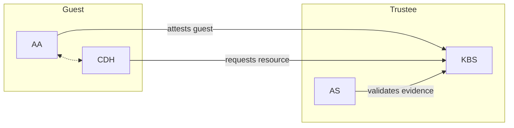
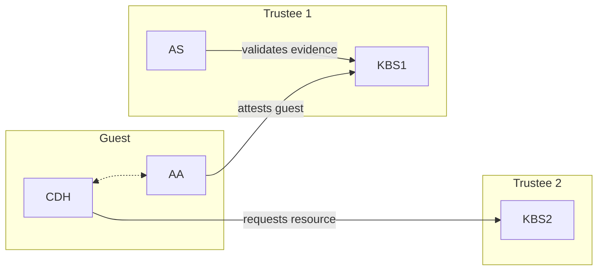

# 密钥代理服务（Key Broker Service）

> 说明：本文件是 `kbs/README.md` 的简体中文译文，原文保持英文不变。总索引见仓库根目录 [custom-文档清单.md](../custom-文档清单.md)。

机密容器密钥代理服务（KBS）提供基于远程证明的身份认证与授权、机密资源存储以及访问控制。
KBS 是[依赖方（Relying Party）](https://www.ietf.org/archive/id/draft-ietf-rats-architecture-22.html)的一种实现。
KBS 自身并不校验证明证据，而是以插件的形式支持不同的外部组件来验证 TEE 证据，包括：
- [CoCo 证明服务（CoCo AS）](../attestation-service/)（支持[全部插件](../attestation-service/README.md#attestation-service)）
- [Intel Trust Authority（ITA）](src/attestation/intel_trust_authority/)（支持 SGX/TDX/NVIDIA GPU）

# 快速开始

我们提供了一份[快速开始](./quickstart.md)指南，用于在 Ubuntu 22.04 上本地部署 KBS 并进行配置和测试。

## 典型部署形态

KBS 可以部署在多种不同的环境中，包括作为 docker compose 集群的一部分、作为 Kubernetes 集群的一部分，
或者完全不使用任何容器化技术。此外，KBS 还可以以不同的方式与其他证明组件交互。
本节重点介绍 KBS 与其他组件交互的不同方式。

### 后台检查模式（Background Check Mode）

后台检查模式是配置 KBS 与 AS 最常见的方式。
[Background Check](https://www.ietf.org/archive/id/draft-ietf-rats-architecture-22.html#section-5.2) 这一术语来自 RATS 架构。
在后台检查模式下，KBS 会在证明代理（attestation agent）校验完硬件证据之后，才向机密 Guest 释放机密。


在后台检查模式下，KBS 是依赖方，AS 是验证方。

后台检查模式的用法与示例可参见[此处](./quickstart.md#background-check-mode)。

### 护照模式（Passport Mode）

护照模式将资源供给与证据校验解耦。
在后台检查模式下，这两项任务其实已经由不同的组件分别承担，
但在护照模式下，它们之间的解耦程度更高。
[Passport](https://www.ietf.org/archive/id/draft-ietf-rats-architecture-22.html#section-5.1) 这一术语来自 RATS 架构。

在护照模式下，会有两个 KBS：一个使用 KBS 来校验证据，另一个用于供给资源。



在 RATS 护照模型中，客户端通常直接连接验证方以获取证明令牌（即"护照"）。
在 CoCo 中我们不支持直接连接 AS，因此由 KBS1 充当中间人。
KBS1 与 AS 共同构成验证方。
KBS2 则是依赖方。

护照模式适用于资源供给与证明由不同实体分别处理的场景。

后台检查模式的用法与示例可参见[此处](./quickstart.md#passport-mode)。

# 进阶主题

## 手动构建 KBS

如果你不想使用社区版本的 KBS（[built-in-as](https://github.com/confidential-containers/trustee/pkgs/container/staged-images%2Fkbs)、[grpc-coco-as](https://github.com/confidential-containers/trustee/pkgs/container/staged-images%2Fkbs-grpc-as)），可以选择从源码构建。

### Docker 镜像

构建 KBS 容器镜像（后台检查模式，使用原生 AS）：

```shell
cd ..
DOCKER_BUILDKIT=1 docker build -t kbs:coco-as . -f kbs/docker/Dockerfile
```

### 二进制文件

Makefile 支持许多其他配置参数。

例如：
```shell
make background-check-kbs [AS_TYPES=?] [COCO_AS_INTEGRATION_TYPE=?] [ALIYUN=?]
```

各参数含义：
- `AS_TYPES`：KBS 支持多种后端证明服务。`AS_TYPES` 用于选择使用哪个验证方。可选项为 `coco-as` 与 `intel-trust-authority-as`。
- `COCO_AS_INTEGRATION_TYPE`：KBS 可以通过多种方式连接 CoCo AS。`COCO_AS_INTEGRATION_TYPE` 可设为 `grpc` 或 `builtin`。使用 `grpc` 时，KBS 会与 AS 建立远程连接。如果你是手动构建和配置各组件的，需要自行做好配置以确保该连接能够建立。与护照模式类似，当机密供给与证明校验不在同一范围内时，远程 AS 会很有用。使用 `builtin` 时，KBS 将 AS 作为一个 crate 使用。如果你希望避免远程连接带来的复杂性，推荐采用这种方式。
- `ALIYUN`：KBS 支持将阿里云 KMS 作为机密存储后端。设为 `true` 以启用该特性的构建。默认为 `false`。
- `EXTERNAL_PLUGIN`：对[外部 gRPC 插件](docs/ext_plugin.md)的支持。默认为 `true`。设为 `false` 可构建一个无法承载外部插件的 KBS。

## 外部插件

KBS 支持使用任何支持 gRPC 的语言编写的外部插件。
外部插件以独立服务的形式运行，并通过 gRPC 与 KBS 通信，与编译进二进制的 Rust 插件共存。

### 构建时启用外部插件支持

外部插件支持默认会编译进 KBS。除非配置中声明了 `external` 插件条目，否则不会暴露任何端点。
默认构建下有两点会无条件发生变化：`/metrics` 会增加三个 `kbs_plugin_*` 指标族，在配置插件之前它们一直上报零值；并且 KBS 会将 ring rustls provider 安装为进程级的默认 provider。

如需构建一个不带该特性的 KBS：

```shell
EXTERNAL_PLUGIN=false make
```

### 插件配置

外部插件在 KBS 的 TOML 配置中以单个 `external` 插件条目注册。每个后端是 `backends` 数组中的一个内联表：

```toml
[[plugins]]
name = "external"
backends = [
  { name = "my-plugin", endpoint = "http://127.0.0.1:50051" },
  { name = "other-plugin", endpoint = "https://127.0.0.1:50052", ca_cert_path = "/etc/kbs/ca.pem" },
]
```

端点 scheme 决定传输方式：`http://` 表示明文，`https://`
表示 TLS，且必须提供 `ca_cert_path`。

插件可通过 `/kbs/v0/external/<name>/...` 访问。

更多细节请参见 [`docs/ext_plugin.md`](docs/ext_plugin.md)。

## HTTPS 支持

KBS 可以使用 HTTPS。这由 openssl crypto backend 提供支持。

如果你需要用于测试的自签名证书，请参考[该文档](docs/self-signed-https.md)。

## 存储后端

KBS 可以使用不同的后端存储。`LocalFs` 始终会被内置。
`ALIYUN` 决定是否构建阿里云 KMS 支持，可选项为
`true` 或 `false`（默认）。更多细节请参考[该文档](docs/config.md#repository-configuration)。

## 实验性特性

此处以实验性编译期特性的形式提供对 KBS 协议的 PQC（后量子密码）算法支持，用以替代传统密码学方法。
可通过在构建时按需追加 `PQC_EXPERIMENTAL=?` 参数来启用，例如：

```shell
PQC_EXPERIMENTAL=true make
```

**请注意，启用该特性会扩展对指定 PQC 算法的支持，但同时仍会支持传统算法。不过，若在 guest components 中启用该特性，则此处也必须启用该特性，才能支持使用新的 `TeePubKey::AKP` 类型的资源请求。**

## 参考资料

### 证明协议
KBS 实现并支持一种简单的、与厂商和硬件无关的
[实现协议](./docs/kbs_attestation_protocol.md)来完成证明。

### API（接口）
KBS 实现了一个基于 HTTP 的、符合 [OpenAPI 3.1](https://spec.openapis.org/oas/v3.1.0) 规范的 API。
该 API 在其 [OpenAPI 格式规范](./docs/kbs.yaml)中有正式描述。

### 资源存储后端
KBS 存储资源数据的[资源存储后端](./docs/resource_storage_backend.md)。

### 配置
可以向 KBS 提供一份自定义的 [JSON 格式配置文件](./docs/config.md)来完成配置。

### 策略
[示例策略](./sample_policies/)可作为编写你自己的资源策略的起点。
策略引擎测试所使用的其他示例策略位于 [`deps/policy-engine/test_data/`](../deps/policy-engine/test_data/)。

### 证明令牌校验
KBS 如何校验证明令牌、如何配置信任锚，以及 AS 令牌签名与 KBS `[attestation_token]` 设置之间的关系，
记录在[证明令牌校验](./docs/attestation_token_verification.md)中。

### 速率限制
为什么针对单个客户端的速率限制应当放在 KBS 前置代理上，参见[速率限制](./docs/rate-limiting.md)。

## 相关工具

### KBS Client（KBS 客户端）
我们提供了 [KBS client](../tools/kbs-client//README.md)，它是一个 Rust SDK 及命令行工具。
