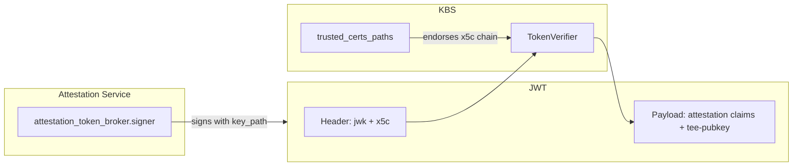

# 证明令牌校验

> 说明：本文件是 `kbs/docs/attestation_token_verification.md` 的简体中文译文，原文保持英文不变。总索引见仓库根目录 [custom-文档清单.md](../../custom-文档清单.md)。

在 RCAR 证明握手成功之后，证明服务（AS）会签发一个证明结果令牌（JWT）。
KBS 使用该令牌来授权资源请求，并提取 TEE 公钥以用于对机密载荷进行 JWE 加密。

本文档说明 KBS **在何时**校验证明令牌、信任锚**如何**配置，
以及 AS 的签名材料与 KBS 校验设置之间的关系。

RCAR 协议流程请参见 [KBS 证明协议](./kbs_attestation_protocol.md)。
`[attestation_token]` 配置参考请参见
[config.md](./config.md#attestation-token-configuration)。
令牌 claim 结构请参见
[证明令牌](../../attestation-service/docs/attestation_token.md)。

## KBS 何时校验证书

KBS 可以通过两种方式对资源请求进行认证：

| 方式 | 请求头 | 令牌校验 |
|--------|----------------|-------------------|
| **会话 Cookie** | `Cookie: kbs-session-id=...` | KBS 查找证明会话，并复用在 `/kbs/v0/attest` 处存储的令牌（该 JWT 在每个请求中仍会被校验）。 |
| **Bearer 令牌** | `Authorization: Bearer <JWT>` | 通过 `[attestation_token]` 信任锚进行完整的 JWT 校验。 |

`kbs-client` 工具使用 Cookie 方式，而 CoCo 通常使用 Bearer 令牌方式。

以下情况会使用 **Bearer** 方式：

- 某个依赖方（包括[护照模式](../quickstart.md#passport-mode)下另一个独立的 KBS）
  通过带外方式收到令牌，必须独立地对其进行校验。
- 客户端发送 `Authorization: Bearer`，而不是（或在取得有效会话 Cookie 之前）使用会话 Cookie。

在这两种方式下，KBS 都会依据令牌 claim 对资源策略进行求值；对于加密响应，
还会从 JWT 载荷中提取 TEE 公钥。

## 信任链总览

对于 CoCo AS 签发的令牌，校验过程分为两步：

1. **签名校验** —— KBS 从 JWT 头部找到签名密钥，并校验 JWT 签名。
2. **密钥背书**（当 `insecure_header_jwk = false` 时）—— KBS 检查头部 `jwk`
   是否有 `x5c` 证书链作为支撑，且该证书链能链接到 `trusted_certs_paths` 中的某个根证书。



在 **AS 侧**，在 `attestation_token_broker.signer`（内置 CoCo AS）
或独立 AS 配置中的对应小节下配置签名材料：

```toml
[attestation_service.attestation_token_broker.signer]
key_path = "/path/to/token.key"
cert_path = "/path/to/token-cert-chain.pem"
```

`cert_path` 指向的 PEM 证书链会作为 `jwk.x5c` 嵌入 JWT 头部。该链中的根 CA
证书必须列在 KBS 的 `trusted_certs_paths` 中。

在 **KBS 侧**：

```toml
[attestation_token]
trusted_certs_paths = ["/path/to/ca-cert.pem"]
insecure_header_jwk = false
```

如果省略 `signer`，AS 会生成一个临时密钥对。来自这类部署的令牌
只有在 `insecure_header_jwk = true` 时才能被校验（仅用于测试）。

## 按 JWT 头部区分的校验路径

KBS 根据 JWT 头部所包含的内容来选择签名密钥。

### 头部含 `jwk`

CoCo AS 的令牌采用这种方式：它将签名公钥嵌入 JWT 头部，通常还会附带 `x5c`
证书链。

当 `insecure_header_jwk = false` 时（生产环境推荐）：

- 头部 `jwk` 必须包含一个非空的 `x5c` 链。
- 叶子证书必须与该 `jwk` 公钥相匹配。
- 该链必须能通过 `trusted_certs_paths` 中的某个证书校验通过。
- 如果 `trusted_certs_paths` 为空，校验失败。

当 `insecure_header_jwk = true` 时（仅用于测试）：

- KBS 直接使用头部 `jwk`，不检查 `x5c` 或 `trusted_certs_paths`。
- JWT 签名仍会被校验，但能够替换头部 `jwk` 的攻击者
  可以让 KBS 接受用任意密钥签名的令牌。

### 头部含 `kid`

Intel TA 令牌在头部用 `kid` 来标识签名密钥。KBS 从
`trusted_jwk_sets` 中查找该密钥：

```toml
[attestation_token]
trusted_jwk_sets = ["https://portal.trustauthority.intel.com"]
```

该路径**不受** `insecure_header_jwk` 影响。当使用 Intel TA 作为
证明后端时，还需在 `[attestation_service]` 下配置 `certs_file` ——
该设置用于 RCAR 证明步骤，而不是用于 KBS 的
`[attestation_token]` 校验。

## TEE 公钥提取

JWT 签名校验通过之后，KBS 会从令牌载荷中提取 Guest 的 TEE 公钥，
用于封装资源加密密钥（JWE）。以下内置 claim 路径会被自动尝试：

| 令牌类型（Token Type） | 默认 claim 路径（Default Claim Path） |
|------------|-------------------|
| CoCo AS（旧版） | `/customized_claims/runtime_data/tee-pubkey` |
| Intel TA | `/tdx/attester_runtime_data/tee-pubkey` |
| Intel TA（vTPM） | `/tdx/attester_user_data/tee-pubkey` |
| EAR | `/submods/cpu0/ear.veraison.annotated-evidence/runtime_data_claims/tee-pubkey` |
| 通用 | `/tee-pubkey` |

如果你的令牌把密钥存放在其他位置，可使用 `extra_teekey_paths` 添加自定义路径。

## 部署示例

### Docker Compose 集群

`kbs/config/docker-compose/` 下的 `setup` 服务会生成本地信任链：

| 文件 | 作用 |
|------|------|
| `ca.key` / `ca-cert.pem` | 用于令牌签名的根 CA |
| `token.key` | AS 令牌签名私钥 |
| `token-cert.pem` | 签名密钥的叶子证书 |
| `token-cert-chain.pem` | 叶子 + 根组成的证书链（供 AS `signer.cert_path` 使用） |

AS 的配置为：

```json
"signer": {
    "key_path": "/opt/confidential-containers/kbs/user-keys/token.key",
    "cert_path": "/opt/confidential-containers/kbs/user-keys/token-cert-chain.pem"
}
```

KBS 的配置为：

```toml
[attestation_token]
trusted_certs_paths = ["/opt/confidential-containers/kbs/user-keys/ca-cert.pem"]
```

完整的 docker-compose 流程请参见 [KBS 集群](./cluster.md)。

### 内置 CoCo AS（本地开发）

`kbs/config/` 下的示例配置通常会将 `insecure_header_jwk = true`，
因为没有配置稳定的签名证书。这仅在本地测试中是可接受的。

若要为内置 AS 建立持久的信任链，需要同时配置两侧：

```toml
[attestation_token]
trusted_certs_paths = ["./work/ca-cert.pem"]
insecure_header_jwk = false

[attestation_service]
type = "coco_as_builtin"

[attestation_service.attestation_token_broker.signer]
key_path = "./work/token.key"
cert_path = "./work/token-cert-chain.pem"
```

### 护照模式

在护照模式下，一个 KBS（带 AS）负责签发令牌，第二个 KBS 负责供给资源。
资源 KBS 必须信任该令牌签发方：

```toml
[attestation_token]
trusted_certs_paths = ["./work/ca-cert.pem"]
insecure_header_jwk = false
```

分步示例请参见 [quickstart.md](../quickstart.md#passport-mode)。

### Intel Trust Authority（英特尔信任权威）

```toml
[attestation_token]
trusted_jwk_sets = ["https://portal.trustauthority.intel.com"]

[attestation_service]
type = "intel_ta"
base_url = "https://api.trustauthority.intel.com"
api_key = "<API key>"
certs_file = "https://portal.trustauthority.intel.com"
```

## 安全须知

- 只要令牌头部携带 `jwk`，生产环境中就应保持 `insecure_header_jwk = false`。
- `trusted_certs_paths` 中只应包含由你运营或明确信任的 CA。
- 轮换 AS 签名密钥时，需要在 AS 侧更新 `signer`，并确保新的根证书或中间证书已加入 KBS 的 `trusted_certs_paths`。
- 基于 Cookie 的会话避免了每次请求都传输 JWT，但仍然依赖会话存储的完整性与过期机制（并且 KBS 在使用前仍会校验该 JWT）；当令牌被直接提交给 KBS 或外部依赖方时，Bearer 校验是必需的。
