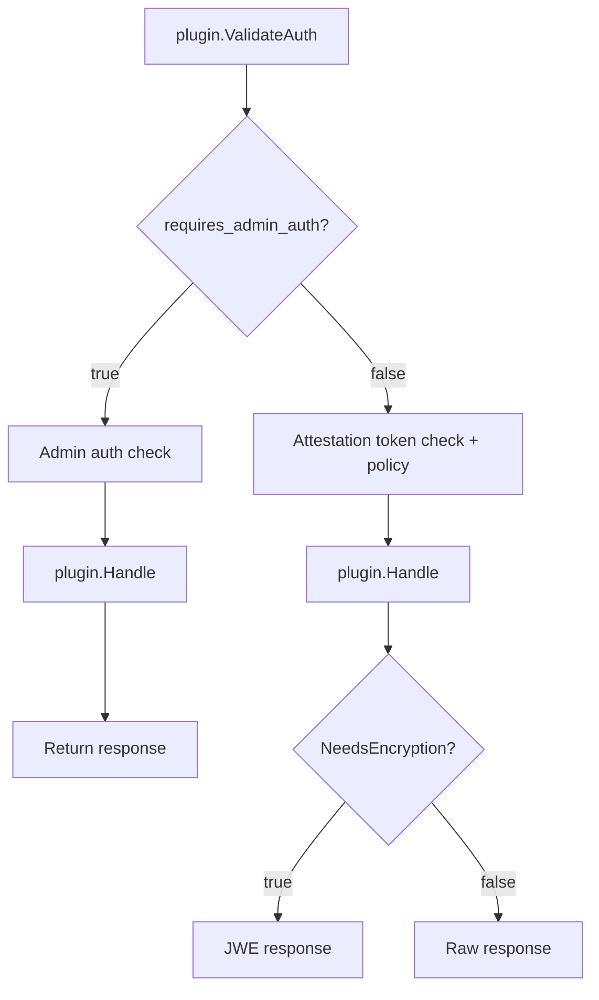

# 外部插件

> 说明：本文件是 `kbs/docs/ext_plugin.md` 的简体中文译文，原文保持英文不变。总索引见仓库根目录 [custom-文档清单.md](../../custom-文档清单.md)。

KBS 外部插件是独立的 gRPC 服务，用于以自定义端点扩展 KBS。
当客户端向 `/kbs/v0/external/<plugin-name>/...` 发送请求时，
KBS 会通过 gRPC 把它转发给相应的插件，并把插件的响应返回给客户端。

这使你能够增加新的能力 —— secret 注入、策略评估、证书签发、自定义密钥管理 ——
而无需修改 KBS 代码库。每个插件都以独立进程或容器的形式运行，
并通过 [`protos/plugin.proto`](../../protos/plugin.proto) 中定义的
`kbs.plugin.v1.KbsPlugin` gRPC 服务与 KBS 通信。

多个插件以 backend 的形式注册在 KBS 配置中的单个 `external` 插件条目之下。
KBS 会根据 `/kbs/v0/external/` 之后的第一个路径段把请求路由到正确的 backend。

### 架构：stub 插件与真实插件

这里有两个不同的层次：

- **树内 stub 插件** —— `external_plugin` 是 KBS 的一个树内插件（默认内置；
可以用 `EXTERNAL_PLUGIN=false make` 去掉），它只是一个路由 stub。
它处理认证、证明与 JWE，然后通过 gRPC 把请求转发给 URL 中所指明的 backend。

- **树外插件** —— 真正的插件实现是**位于 Trustee 仓库之外**的独立进程或容器。
你负责编写和维护它们；KBS 通过 `KbsPlugin` gRPC 接口与它们通信。
Trustee 核心不了解也不关心它们的内部实现。
Trustee 负责把 REST 请求代理到已配置的插件，但每个插件自行负责其 API 版本管理与向后兼容。
缺陷也应报告到相应的插件仓库。


KBS 相关配置参见 [`config.md`](config.md#external-plugin-configuration)。

---

## 认证模型

KBS 对每一个插件请求都会通过两条认证路径之一进行控制。
在转发请求之前，KBS 会调用插件的 `ValidateAuth` RPC，询问应使用哪条路径：



- **`requires_admin_auth = true`** —— KBS 在转发之前校验管理员凭据。
适用于调用方是运维人员而非 TEE 工作负载的供给类端点。

- **`requires_admin_auth = false`** —— KBS 要求一个有效的证明令牌，
并评估已配置的资源策略。这是 TEE 工作负载获取 secret 的标准路径。

- **`NeedsEncryption`** —— 在 `Handle` 返回之后，KBS 会询问该响应是否应当
使用 TEE 的临时公钥进行 JWE 加密。对任何包含机密材料的响应都返回 `true`。
JWE 确保只有完成 RCAR 握手的那个 TEE 能够解密该响应 ——
仅靠 HTTPS 对于 secret 是不够的。

  > `NeedsEncryption` 只在证明门禁路径上被调用。JWE 需要来自证明令牌的 TEE 公钥，
  > 而这在 admin 路径上是不可用的。

单个插件可以同时实现这两条路径：在 `ValidateAuth` 中检查 `method` 或 `path` 来区分，
例如 `POST`（供给 secret）走 admin 认证，`GET`（获取 secret）走证明门禁 + 加密。

---

## gRPC 协议

插件实现 [`protos/plugin.proto`](../../protos/plugin.proto) 中的
`kbs.plugin.v1.KbsPlugin` 服务：

1. **`Handle`** —— 处理从 KBS 转发过来的 HTTP 请求
2. **`ValidateAuth`** —— 按请求决定使用 admin 认证还是证明门禁
3. **`NeedsEncryption`** —— 决定是否对响应进行 JWE 加密

一个完整可运行的示例位于
[`kbs/test/external_plugin_test_server.rs`](../test/external_plugin_test_server.rs)。

### 请求与响应字段

**`PluginRequest`：**

| 字段 | 类型 | 说明 |
|---|---|---|
| `body` | bytes | 原始 HTTP 请求体 |
| `query` | map<string, string> | URL 查询参数 |
| `path` | repeated string | backend 名称之后的路径段。对于 `/kbs/v0/external/my-plugin/a/b`，它是 `["a", "b"]` —— KBS 在转发前会剥离 backend 名称 `my-plugin` |
| `method` | string | HTTP 方法（`GET`、`POST`、`PUT`、`DELETE`） |

**`PluginResponse`：**

| 字段 | 类型 | 说明 |
|---|---|---|
| `body` | bytes | 返回给调用方的响应体 |
| `status_code` | int32 | HTTP 状态码提示。`0` 或 `2xx` 会原样返回响应体。`404` 会让调用方收到 404。任何其他非 2xx 都被视为插件错误（调用方收到 401） |
| `content_type` | string | 保留供将来使用；目前被 KBS 忽略 |

### 错误处理

路径中缺少 backend 名称、未注册的 backend 名称、gRPC `NOT_FOUND` 状态、
或 `status_code` 为 `404`，都会导致向调用方返回 `404 Not Found`。
所有其他插件错误（gRPC 失败或其他非 2xx 的 `status_code` 取值）都会导致 `401 Unauthorized`。
错误细节会记录在服务端日志中。

---

## 构建与打包

把你的插件构建为一个二进制，并与 KBS 一起运行。
插件只需要监听一个 TCP 端口并实现 `KbsPlugin` gRPC 服务。

在把插件接入 KBS 之前，先用 grpcurl 直接测试它：

```bash
grpcurl -plaintext -d '{"method":"GET","path":["test"]}' \
  127.0.0.1:50051 kbs.plugin.v1.KbsPlugin/Handle
```

---

## 部署

### 独立部署

把插件与 KBS 作为独立进程运行：

```bash
# 终端 1：启动插件
./my-plugin

# 终端 2：启动 KBS
cargo run --bin kbs -- --config-file kbs-config.toml

# 终端 3：测试
curl http://127.0.0.1:8080/kbs/v0/external/my-plugin/test
```

使用本仓库中的测试配置：

```bash
# 终端 2
cd kbs && cargo run --bin kbs -- \
    --config-file test/config/external-plugin.toml

# 终端 3（端口 8085 与插件名与该测试配置一致）
curl http://127.0.0.1:8085/kbs/v0/external/echo-test/test
```

### 端到端测试

`kbs/test/` 的 Makefile 包含面向完整 KBS 到插件流程的集成测试：

| Target | 说明 |
|---|---|
| `test-ext-plugin` | 明文插件位于 `:50051`，KBS 位于 `:8085` |
| `test-ext-plugin-metrics` | 校验 `/metrics` 中存在插件计数器 |
| `test-ext-plugin-tls` | TLS 插件位于 `:50052`，KBS 位于 `:8086` |
| `test-ext-plugin-attest` | 位于 `:8087` 的证明门禁访问 |
| `test-ext-resource-plugin` | 位于 `:8088` 的资源存储往返测试 |
| `test-ext-resource-plugin-tls` | 位于 `:8089` 的、通过 TLS 插件连接的资源存储测试 |
| `e2e-ext-plugin` | 运行全部六个测试并自动清理 |
| `stop-ext-plugins` | 停止所有外部插件进程 |

```bash
cd kbs/test && make e2e-ext-plugin
```

**Echo 测试**（`test-ext-plugin`、`test-ext-plugin-tls`、`test-ext-plugin-attest`）校验请求转发：
测试插件会把请求细节以明文回显回来。证明相关的变体还会检查未认证请求被拒绝，
以及有效的证明令牌可以授予访问权限。

**资源往返测试**（`test-ext-resource-plugin`、`test-ext-resource-plugin-tls`）演练完整的供给与获取流程：
一次 admin POST 把一个随机的 16 字节 secret 存入插件的内存存储中
（通过 `InsecureAllowAll` 施加 admin 认证门禁），客户端完成证明以获得令牌，
随后使用该令牌的 GET 请求取回相同的字节。通过 `diff` 确认往返一致。
TLS 变体只在 KBS 到插件的 gRPC 连接上启用 TLS；
在两个资源测试中，客户端到 KBS 这一段都保持明文 HTTP。

---

## 监控

KBS 在 `/metrics` 上暴露每个插件的 Prometheus 指标：

| 指标 | 类型 | 说明 |
|---|---|---|
| `kbs_plugin_requests_total{plugin_name="..."}` | Counter | 转发给该 backend 的 `Handle` 调用总数 |
| `kbs_plugin_request_duration_seconds{plugin_name="..."}` | Histogram | `Handle` 调用的延迟 |
| `kbs_plugin_errors_total{plugin_name="..."}` | Counter | gRPC 错误总数（所有 RPC） |

`plugin_name` 标签取自 `backends` 数组中的 backend 名称（例如 `echo-test`），
而不是顶层的 `external` 插件名。

```bash
curl http://127.0.0.1:8080/metrics | grep kbs_plugin
```

---

## 故障排查

**启动时连接被拒绝**

```
Error: Initialize 'external' plugin failed

Caused by:
    0: Failed to initialise backend '<name>'
    1: Failed to connect to external plugin
    2: Failed to connect to plugin after retry window
    3: <tonic transport error>
```

插件未运行或端点配置错误。KBS 会在启动时连接所有已配置的 backend，
只要有一个不可达就会退出。请确认插件正在运行，并且 `kbs-config.toml` 中的端点与其绑定地址一致。

**启动时的 TLS 错误**

```
`https://` endpoint requires `ca_cert_path` (PEM file for server certificate verification)
`http://` endpoint is plaintext and must not set `ca_cert_path`; use `https://` for TLS
endpoint must start with `http://` or `https://`
unknown field `tls_mode`
Read CA certificate
```

端点的 scheme 决定了传输方式，并且它是唯一的决定因素：`http://` 表示明文，`https://` 表示 TLS。
`https://` 端点要求在同一个 backend 表中提供 `ca_cert_path`；
`http://` 端点则不得设置它。请确认证书路径存在且可读。

> 未知键会被拒绝。一个带有已被移除的 `tls_mode` 键的 backend
> 会带着 "unknown field" 错误启动失败；请删除该键，让端点 scheme 来决定传输方式。

**请求返回 401**

除 not-found 之外的插件错误（gRPC 失败、插件返回 404 以外的非 2xx 状态码）都会导致 401。
请查看 KBS 服务端日志中的具体错误信息，它会与请求一起以 ERROR 级别记录。

**请求返回 404**

```
GET /kbs/v0/external/my-plugin/test -> 404 Not Found
```

可能是该子 backend 名称（这里是 `my-plugin`）没有配置在 `external` 插件之下、
backend 自身报告了 not-found，或者没有名为 `external` 的插件被注册。
请检查 `kbs-config.toml` 中是否存在一个 `name = "external"` 的 `[[plugins]]` 条目。
如果二进制是以 `EXTERNAL_PLUGIN=false`（或 `--no-default-features` 且不带 `external-plugin`）构建的，
该条目根本不会被识别，KBS 会无法解析配置。
